# PlayMe — Jeux de réflexion

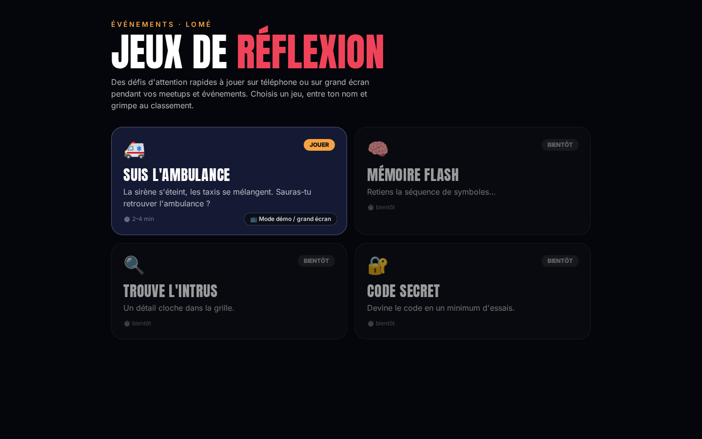

**PlayMe** rassemble des jeux de réflexion courts pour animer les événements tech (meetups, conférences, GDG, stands). On y joue seul sur son téléphone, ou sur grand écran pour toute la salle. Chaque jeu dure quelques minutes et alimente un classement local.

## Jeux

| Jeu | Statut | Joueurs | Description |
|---|---|---|---|
| 🚑 Suis l'ambulance | ✅ Jouable | 1 (ou toute la salle en mode démo) | La sirène s'éteint, les 12 taxis se mélangent selon 8 motifs : retrouve l'ambulance. 5 niveaux + Expert. |
| 🧠 Mémoire flash | 🔜 Bientôt | — | Retiens la séquence de symboles. |
| 🔍 Trouve l'intrus | 🔜 Bientôt | — | Un détail cloche dans la grille. |
| 🔐 Code secret | 🔜 Bientôt | — | Devine le code en un minimum d'essais. |

## Fonctionnalités

| Fonctionnalité | État |
|---|---|
| Classement local (nom du joueur, score, niveau, temps), stocké dans le navigateur | ✅ |
| Mode démo / grand écran avec compte à rebours pour le public | ✅ (Suis l'ambulance) |
| Son (Web Audio, sans fichier) activable et mémorisé, vibration sur mobile | ✅ (Suis l'ambulance) |
| Niveau Expert débloqué après le niveau 5 | ✅ (Suis l'ambulance) |
| Limite de 5 s pour répondre (solo et multi) | ✅ (Suis l'ambulance) |
| Multijoueur local (1 à 3 joueurs sur le même appareil, multi-touch) | ✅ (Suis l'ambulance) |
| Partage du score (feuille native, sinon copier + WhatsApp, Facebook, X, Telegram, image 1080×1350) | ✅ |
| Défi partagé (lien `?defi=` qui rejoue les mêmes mélanges) | ✅ (Suis l'ambulance) |

<details><summary>Captures</summary>

| Mobile | Mélange | Victoire | Mode démo |
|---|---|---|---|
| 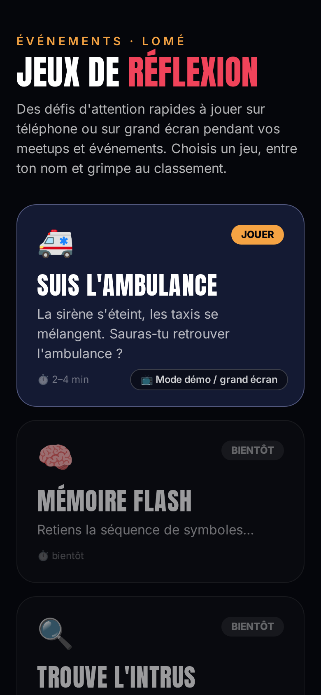 | 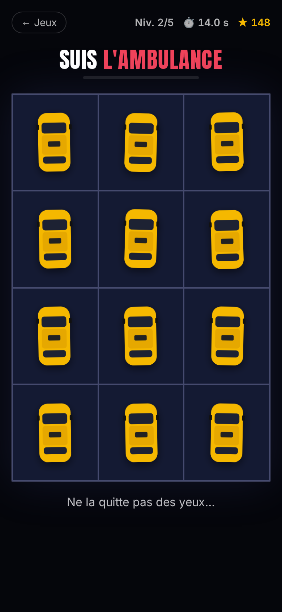 | 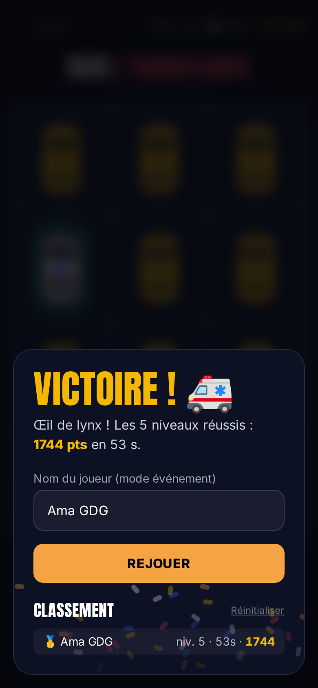 | 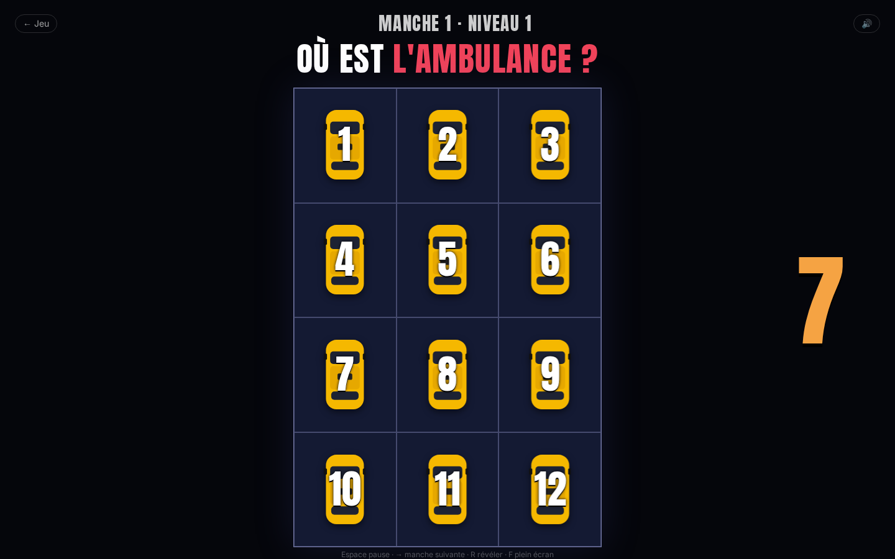 |

| Config multi | 2 joueurs | 3 joueurs | Podium | Partage | Défi |
|---|---|---|---|---|---|
| 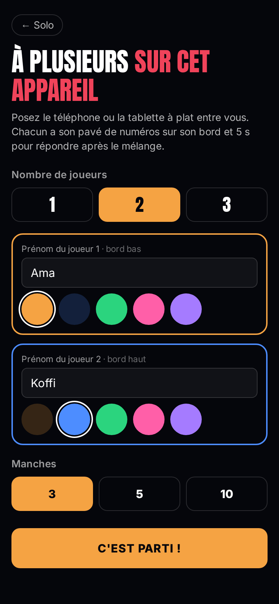 | 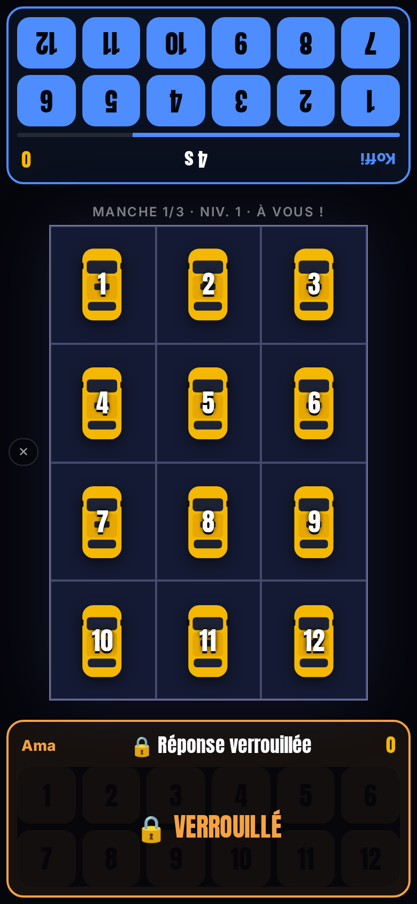 | 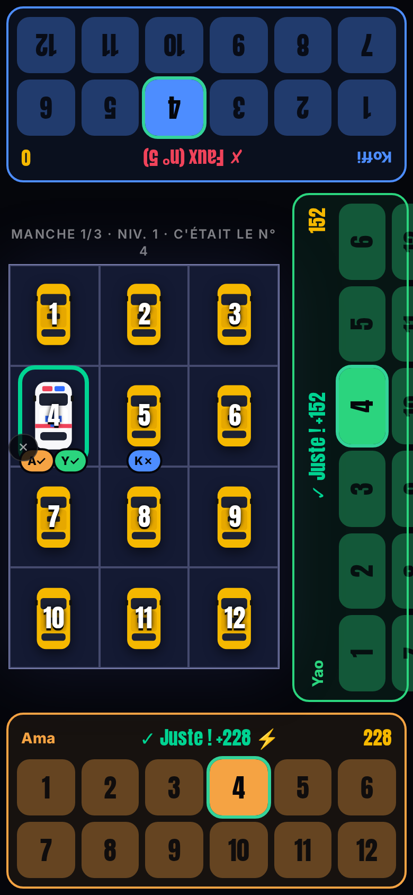 | 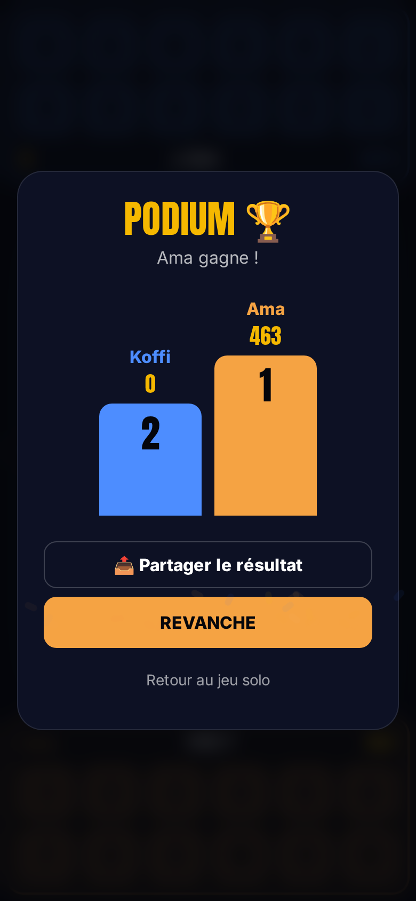 | 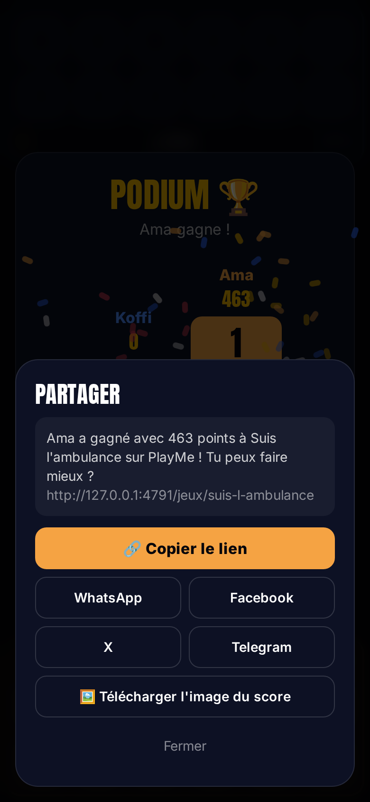 | 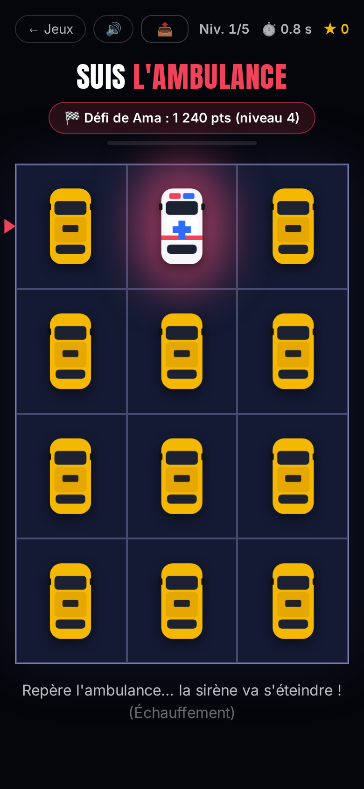 |

</details>

## Démarrage rapide

Prérequis : **Node.js 20+** et npm.

```bash
git clone https://github.com/Donchaminade/playme.git
cd playme
npm install
npm run dev       # serveur de développement Vite
npm test          # tests Vitest (vitest run)
npm run build     # vérification TypeScript + build de production dans dist/
npm run preview   # sert dist/ sur http://127.0.0.1:4791
```

## Liens utiles

| Lien | Effet |
|---|---|
| `/` | Hub des jeux |
| `/jeux/suis-l-ambulance` | Le jeu |
| `/jeux/suis-l-ambulance?niveau=3` | Démarre directement au niveau N (le 6 seulement s'il est débloqué) |
| `/jeux/suis-l-ambulance/demo` | Mode démo / grand écran |
| `/jeux/suis-l-ambulance/demo?vitrine=1` | Vitrine : chaque motif une fois, avec son nom |
| `/jeux/suis-l-ambulance?mode=multi` | Multijoueur local (2–3 joueurs) |
| `/jeux/suis-l-ambulance?defi=CODE` | Défi : rejoue les mêmes mélanges qu'un ami et compare les scores |

**Raccourcis du mode démo** : `Espace` pause · `→` manche suivante · `R` révéler · `F` plein écran.

### Suis l'ambulance : motifs et niveaux

À chaque vague, **les 12 voitures bougent** selon un motif tiré au hasard (jamais deux fois le même d'affilée) :

| Motif | Description |
|---|---|
| Paires voisines | 6 échanges entre cases adjacentes (11 pavages possibles) |
| Cercle | les 10 cases du pourtour tournent de 1 ou 2 crans (horaire / anti-horaire), le centre s'échange |
| Carrousels 2×2 | deux blocs 2×2 tournent d'un quart de tour, la colonne restante s'échange |
| Diagonales en X | croisements en diagonale : une voiture passe dessus (agrandie, ombre), l'autre dessous |
| Tapis roulant | colonnes ou lignes glissent d'une case, la voiture du bout revient par un arc extérieur |
| Serpent | toutes les voitures avancent d'une case le long d'un parcours en S |
| Miroir | symétrie haut-bas ou gauche-droite |
| Échanges lointains | 2–3 échanges à distance par-dessus, le reste en paires voisines |

| Niveau | Vagues | Base / vague | Motifs | Rythme |
|---|---|---|---|---|
| 1 Échauffement | 7 | 680 ms | voisines, cercle, carrousels, tapis | 1 rafale |
| 2 Croisements | 8 | 620 ms | + diagonales | 1 rafale, 1 feinte |
| 3 Embrouilles | 9 | 565 ms | + serpent, miroir | 1 rafale, 1 feinte |
| 4 Grand mix | 10 | 515 ms | + échanges lointains | 2 rafales, 1 feinte, final |
| 5 Tempête | 12 | 470 ms | tout | 2 rafales, 2 feintes, final |
| 6 Expert | 14 | 430 ms | tout | 3 rafales, 2 feintes, final (débloqué après le N5) |

Dans une partie, les vagues accélèrent progressivement (×1,6 à ×1,8). Planchers : 320 ms pour une vague normale, 300 ms pour le final, 260 ms pour une rafale.

Rafale = 2–3 vagues au moins 2× plus rapides puis respiration ; feinte = ralentit presque à l'arrêt puis repart ; final = 2–3 vagues vives puis arrêt net avec rebond. Chaque trajectoire est vérifiée par échantillonnage (pas de collision, pas de saut, l'ambulance n'est jamais recouverte) ; toutes les voitures s'orientent de la même façon, l'orientation ne trahit donc rien.

Lien animateur : `/jeux/suis-l-ambulance?niveau=N`.

Diagonales : les deux paires de croisements d'un même bloc sont décalées d'environ 20 % dans le temps (jamais les 4 voitures au centre en même temps).

### Multijoueur local

Bouton « 👥 2–3 joueurs sur cet appareil » (ou `?mode=multi`). Écran de réglage : nombre de joueurs, prénom et couleur de chacun, 3, 5 ou 10 manches (5 par défaut, niveau croissant).

- **Disposition** : plateau au centre, un pavé de 12 numéros par joueur, tourné vers lui. 2 joueurs : un en bas, un en haut (pivoté 180°). 3 joueurs : bas, haut, et bord droit (pivoté −90°), pour que chacun ait son bord et que les mains ne se croisent pas.
- **Ordinateur** (écran ≥ 1024 px et souris) : pavés à gauche, à droite et en bas, sans rotation ; touches `1`…`=`, `Q`…`]`, `A`…`\` (libellés selon la disposition du clavier).
- **Réponse** : 5 s visibles par joueur ; la réponse est verrouillée au premier appui et cachée jusqu'à la révélation (pointer events, multi-touch simultané).
- **Points** : bonne réponse 100 + bonus rapidité jusqu'à 100 (`100 × (1 − t/5000)`), + 50 au(x) plus rapide(s) parmi les bonnes réponses (égalité exacte : tous). Faux ou hors délai : 0. Classement avec ex-aequo (1, 1, 3). Tableau des scores entre les manches, podium animé à la fin.

### Partage et défi

Bouton **Partager** sur l'écran de fin (solo et multi) et dans l'en-tête du jeu. Il utilise `navigator.share` (avec l'image si possible), sinon un panneau : copier le lien, WhatsApp, Facebook, X, Telegram, télécharger l'image du score (canvas 1080×1350). Aucun serveur, aucune clé.

Le lien `?defi=CODE` contient score, niveau, prénom et une graine (base64url + somme de contrôle ; un code altéré est ignoré). L'ami voit un bandeau, joue les mêmes mélanges, puis une comparaison s'affiche. Les balises Open Graph / Twitter utilisent `public/og-image.png`.

## Structure du projet

```text
playme/
├── index.html                 # point d'entrée, balises SEO
├── public/                    # favicon, robots.txt, og-image.png
├── src/
│   ├── main.tsx               # routes : /, /jeux/:slug, /jeux/:slug/demo
│   ├── index.css              # Tailwind 4 + thème (couleurs nuit, taxi, sirene, orange ; police titre)
│   ├── pages/
│   │   ├── Hub.tsx            # grille des cartes de jeux
│   │   └── GamePage.tsx       # charge le jeu (ou sa démo) depuis le registre
│   ├── lib/
│   │   ├── leaderboard.ts     # classement localStorage, partagé par tous les jeux
│   │   ├── multijoueur.ts     # délai 5 s, verrouillage, points, classement (testé)
│   │   ├── defi.ts            # code ?defi=, graines reproductibles (testé)
│   │   ├── partage.ts         # message, liens réseaux, image du score
│   │   └── Partage.tsx        # bouton Partager + panneau de repli
│   └── games/
│       ├── index.ts           # registre des jeux (GameEntry)
│       ├── _modele/           # jeu modèle à copier (non inscrit au registre)
│       └── suis-l-ambulance/
│           ├── logic.ts       # motifs, trajectoires, niveaux, tempo (pur, testé)
│           ├── logic.test.ts  # tests Vitest
│           ├── engine.ts      # animation des vagues (motion)
│           ├── Board.tsx, Car.tsx, ui.tsx
│           ├── sound.ts       # sons Web Audio + vibration
│           ├── partie.ts      # manche seedée (défi)
│           ├── Game.tsx       # partie solo (+ défi)
│           ├── Multi.tsx      # multijoueur local
│           └── Demo.tsx       # mode démo / grand écran
├── shots/                     # captures PNG (les MP4 de contrôle ne sont pas versionnés)
├── shots-multi.mjs           # captures multi/partage/défi (node shots-multi.mjs [video])
├── shots.mjs                  # régénère les captures (Playwright, preview lancée)
└── videos.mjs                 # vidéos de contrôle : node videos.mjs <1-6|demo|bestof>
```

## Stack

React 19 · TypeScript · Vite · Tailwind CSS 4 · motion · React Router · Vitest · Playwright (captures).

## Contribuer

Tu veux ajouter ton propre jeu ? Tout est expliqué dans **[CONTRIBUTING.md](CONTRIBUTING.md)** : workflow, contrat d'un jeu, modèle prêt à copier, règles de qualité et checklist de PR.

## Licence

Licence : à définir par le mainteneur.

## Auteur

**Chaminade Adjolou** ([@Donchaminade](https://github.com/Donchaminade)) · Portfolio : https://donchaminade-alpha.vercel.app
